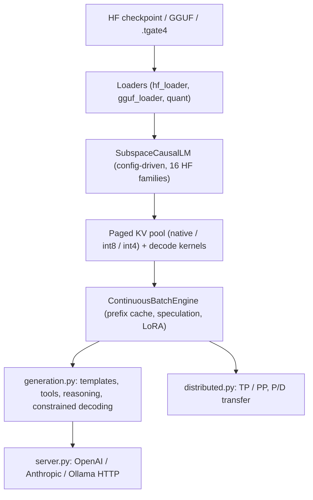

# Architecture

This page is a tour of the code for contributors: how a request moves through the server, and how each subsystem
it touches works. Measured results are in [benchmarks](benchmarks.md); the committed result files are in
`benchmarks/results/`.

## Request lifecycle

1. **HTTP** (`turing/serving/server.py`, `anthropic_api.py`, `ollama_api.py`): the OpenAI, Anthropic and Ollama
   routes share one app. A chat route renders the messages through the model's chat template and builds a
   `GenerationParams` (sampling, stop strings, tools, response schema, thinking budget).
2. **Admission** (`generation.start`): validates the request, builds its logits processors (constrained decoding
   through llguidance, the thinking budget) and adds it to the engine. A request the server cannot serve is rejected
   with 400, and load with 429/503, before anything is streamed.
3. **Scheduling** (`ContinuousBatchEngine`, an asyncio scheduler loop): the prefix cache attaches any cached full
   pages of the prompt; the rest is prefilled in chunks between decode steps (when several requests prefill in the
   same step, their chunks run as one packed forward); then every running request decodes in one batched step.
4. **Model** (`SubspaceCausalLM`): each layer appends its keys and values to the request's pages in the KV pool and
   attends over them through the paged prefill and decode kernels.
5. **Streaming** (`Generation.events()`): tokens are detokenized, stop strings are matched, reasoning is split from
   content and tool calls are held back and emitted parsed; the response ends with a finish reason and usage.

The HTTP layer (`server.py`, `generation.py`, `anthropic_api.py`, `ollama_api.py`, `tools.py`, `structured.py`,
`reasoning.py`, `embeddings.py`, `extract.py`, `pull.py`) is described from the user's side in [serving](serving.md).

---

## 1. Engine (`turing/serving/engine.py`)

`ContinuousBatchEngine` admits requests, prefills them in chunks (512 tokens, or the lane's chunk) between decode
steps, and decodes all running requests in one batched step. Around that loop:

* **Prefix cache** (`prefix_cache.py`): full pages indexed by a chained hash of their tokens and LoRA adapter, reused
  copy-on-write, evicted LRU when the pool is short; store/remove events feed llm-d (`kv_events.py`).
* **Speculative decoding** by prompt lookup: drafts from the request's own tokens, verified in one forward; greedy
  and sampled outputs keep the distribution of plain decoding ([serving §5](serving.md#5-prefix-caching-and-speculative-decoding)).
* **Requests** end at EOS ids, `max_tokens`, a stop string or cancellation; per-request `top_k`, `top_p`,
  `temperature` and a `logits_processor(generated, logits)` hook (used for constrained decoding).
* **Admission and lanes** (`traffic.py`): `AdmissionController` sized to the pool, `LanePolicy` with three lanes.
* **Multi-LoRA** (`turing/models/adapters.py`): PEFT adapters wrap the targeted projections; `forward(adapters=[…])`
  takes one adapter (or none) per batch row.

---

## 2. KV cache (`turing/core/kv_cache.py`)

* **Pool**: one paged pool per model, 16-token pages, sized once from free GPU memory after the weights
  (`--kv-cache-memory-fraction`, default 0.6); off CUDA, 4 GiB or what 64 full-length requests need, whichever is
  less. Each request (`KVCache`) owns a row of the pool's device page table; forks share full pages copy-on-write.
  The engine reserves a request's pages at admission.
* **Storage** (`--kv-cache-dtype`; `auto` is int8 on CUDA and native elsewhere): `native`, `int8` (asymmetric per
  token and KV head, fp16 scale and zero) or `int4` (per group of 32 values).
* **Calibration**: when a low-bit pool is created, the model calibrates it on 4 × 256 random tokens.
  `select_kv_native_layers` stores in the model dtype (`k_hi`/`v_hi`) the layers whose K/V round trip moves the
  next-token distribution by more than 0.02 nats, at most a quarter of the layers. For int4,
  `calibrate_kv_smoothing` divides key channels at 16× their head's median by a power of two and multiplies the
  queries by the same factor, which leaves q·k exact. Results per model are in
  [benchmarks §2](benchmarks.md#2-kv-cache-quality-and-the-layers-it-keeps).
* **Quest page selection** (`--kv-page-budget`): each page keeps the min and max of its keys; a decode step for a
  request of at least `kv_select_min_tokens` (8,192) tokens reads only the highest-scoring share of pages (first and
  last always kept).

---

## 3. Attention kernels and decode (`turing/kernels/`)

The kernels on the serving path run on CUDA only; on MPS and CPU, attention and 4-bit matmuls run in PyTorch:

| Kernel | Module | Used for |
| :--- | :--- | :--- |
| Paged decode | `triton_kv_decode.py` | Fused quantize-and-append, split-K attention over each row's pages, reduction |
| Paged prefill | `triton_kv_prefill.py` | A prompt chunk attending over the request's cached prefix and itself, through the page table |
| FlashInfer prefill | `flashinfer_prefill.py` | Optional (when `flashinfer` imports): chunks of at least 512 tokens over layers stored in the model dtype, without a sliding window or soft-capping |
| int4 GEMM | `triton_w4a16.py` | 4-bit weights, up to `INT4_MAX_ROWS` input rows (§4) |
| Marlin | `marlin.py` | Optional 4-bit GEMM when built with `TURING_BUILD_MARLIN=1` (§4) |
| Sparse GEMV | `triton_sparse_gemv.py` | Activation sparsity on one-row inputs (§4) |

* **CUDA decode**: one step for every running request is a fused quantize-and-append, a split-K attention over each
  row's pages through the page table, and a reduction. The kernel takes the attention scale, sliding window and
  softcap, so those families stay on the fused path. `ModelConfig.decode_attention = "sdpa"` gathers the pages and
  calls SDPA instead (for comparison).
* **CUDA prefill**: the paged prefill kernel reads int8/int4 pages with in-register dequantization, as the decode
  kernel does. For a layer stored in int4 with a prefix already cached, gathering the cache and calling SDPA is
  faster, so that case takes the gather path.
* **CUDA graphs** (`DecodeGraphs`): whole decode steps are captured per batch bucket and replayed; steps with Quest
  replay graphs captured per batch and page-table-width bucket, with page selection computed on the device. MoE
  layers on CUDA run as a grouped GEMM with no host sync (`triton_moe.py`), so they are captured too; steps with LoRA
  adapters run eagerly.
* **Off CUDA** (MPS, CPU): a decode step appends and reads every row of the batch at once (one gather and one
  attention per layer), bit-identical to the per-request path in the tests.

---

## 4. Weights at reduced precision

* **4-bit weights** (`QuantLinear`, `turing/models/quant.py`; `--quantization w4a16-rtn|w4a16-gptq` or a `.tgate4`
  directory): attention and dense-MLP projections are quantized (groups of 64); embeddings, routers and MoE experts
  stay in the model dtype, and so does the LM head unless `--quantize-lm-head` is given. On CUDA a fused Triton int4
  GEMM (`triton_w4a16.py`) handles up to `INT4_MAX_ROWS` (64) input rows; above that, dequantization into a shared
  scratch buffer plus cuBLAS (which wins by 256 rows in the
  [measured crossover](benchmarks.md#3-4-bit-weights-and-activation-sparsity)). When the optional Marlin extension
  is built (`TURING_BUILD_MARLIN=1`, `turing/kernels/marlin.py`) it serves 1–1,024 rows from a repacked copy made at
  load. Off CUDA, weights are dequantized and then multiplied, which saves memory but is slower than dense weights.
  4-bit decodes 2.1× faster than fp16 at batch 1 (154.8 against 72.6 tok/s), and GPTQ costs about 7 GSM8K points on
  Qwen2.5-1.5B-Instruct (57.2% → 50.4%) ([comparison](comparison.md)).
* **Activation sparsity** (`turing/models/activation_sparsity.py`, `--activation-sparsity`, default 0): TEAL-style,
  training-free. Per-projection magnitude thresholds are calibrated on WikiText-2 so that the chosen share of every
  attention and MLP projection input is zero. It applies only to one-row inputs on CUDA, where
  `triton_sparse_gemv.py` skips the weight rows of zero inputs (prefill and batched decode stay dense: they gain no
  speed, and a sparsified prefill breaks attention-sink tokens). It reads a transposed copy of each weight (fp16) or
  a transposed 4-bit copy (4-bit models), built on first use, so the weights take extra memory. End to end on an L4,
  on top of GPTQ it was 28–31% slower at batch 1 (107–112 against 155 tok/s) and cost 4–8 GSM8K points
  ([comparison](comparison.md)).
* **FFN channel pruning** (`--sparsity`, default 0) keeps the FFN channel tiles with the largest weight norms.
  Without retraining it is lossy: 50% raises next-token NLL by +6.8 to +15.8 nats on SmolLM2
  ([benchmarks §10](benchmarks.md#10-ffn-channel-pruning)).

---

## 5. Model (`turing/models/causal_lm.py`)

`SubspaceCausalLM` is one config-driven decoder (`ModelConfig` in `turing/config.py`) that covers the HuggingFace
model types in `hf_loader.FAMILIES`: RMSNorm or LayerNorm (Gemma's `1 + w`), gated or plain MLPs with any HF
activation and biases, learned positions (GPT-2, OPT), partial rotary (GPT-NeoX, Phi), parallel residual (GPT-NeoX,
Phi-2), post-LN and projected embeddings (OPT-350m), Gemma's embedding scale and sandwich norms, attention and final
logit soft-capping (Gemma 2), per-layer sliding windows (Mistral, Gemma 2/3, Phi-3), per-layer RoPE bases (Gemma 3),
q/k norms (Qwen3, Gemma 3, OLMoE) and top-k MoE layers with an optional shared expert (Mixtral, Qwen2/3-MoE, OLMoE).

RoPE (`turing/core/rope.py`) implements default, linear, dynamic NTK, YaRN, LongRoPE, Llama 3 and proportional
scaling as transformers computes them, both as host tables and on the device for CUDA graphs.

`tests/test_hf_parity.py` checks 25 configurations of 16 model types against HuggingFace (prefill, chunked prefill,
decode, stateless calls and batched decode across requests, atol 1e-3). Gemma references use HF's eager attention,
because HF's SDPA path skips Gemma 2's attention soft-capping.

---

## 6. Loading (`turing/models/`)

* **HuggingFace** (`hf_loader.py`): unsupported model types are refused before download. The model is built on the
  meta device and every parameter must be written from the checkpoint, so nothing is served at random
  initialisation and the weights exist once. `--dtype` picks bf16/fp16/fp32 (bf16 checkpoints stay bf16 on CUDA).
* **GGUF** (`gguf_loader.py`, `csrc/turing_gguf_cpp.hpp`): llama.cpp files of every family above except OPT, with
  llama.cpp's tensor names and metadata (Gemma norms, Gemma 2/3 attention scale and sliding pattern, Phi-3's fused
  projections and LongRoPE factors, Llama q/k un-permutation, fused MoE experts). Dequantization is exact for F32,
  F16, BF16, Q4_0, Q4_1, Q5_0, Q5_1, Q8_0 and Q2_K–Q6_K and Q8_K, in NumPy and C++ (bit-exact against ggml's `gguf`
  package in the tests); other types, missing or unexpected tensors and truncated files raise.
  `tests/test_gguf_parity.py` round-trips a tiny HF model of each family through GGUF; `scripts/eval_gguf_parity.py`
  compares 13 real files with llama.cpp (`benchmarks/results/results_gguf_parity_mps.json`).
* **4-bit `.tgate4`** (`quant.py`, `streaming_loader.py`): `turing convert` quantizes layer by layer over the
  safetensors shards (per-expert MoE checkpoints are stacked on the fly), with GPTQ (groups of 64, 1% damping, each
  layer quantized on the outputs of the already-quantized ones) or RTN, and writes packed uint4 codes, fp16 scales
  and uint8 zeros as safetensors plus a config. No dequantized copy is kept.
* **Readers**: safetensors are memory-mapped with `madvise(MADV_WILLNEED)`; `ParallelReader`
  (`csrc/turing_parallel_reader.hpp`, also exported as `NativeAsyncRingReader`) reads in 1 MiB requests with up to 64
  in flight, through io_uring when built with liburing and `pread` threads otherwise; `NativeGDSLoader`
  (`csrc/turing_cufile.hpp`) reads through cuFile when available, else into pinned memory and copies, and reports
  which path ran. Cold reads are measured in [benchmarks §8](benchmarks.md#8-storage-ingestion).

---

## 7. Distributed (`turing/serving/distributed.py`, `turing/models/tensor_parallel.py`, `kv_transfer.py`)

* **Tensor parallelism** shards a loaded model in place: attention heads, MLP and expert intermediate widths and a
  vocabulary-parallel head, with all-reduces over `torch.distributed`.
* **Pipeline parallelism**: stages own contiguous layers and their KV pages and pass activations with send/recv,
  with forward-only 1F1B micro-batching. `DistributedInferenceDriver` on rank 0 drives the steps; the other ranks run
  `worker_loop()`.
* **Prefill/decode disaggregation**: a prefill worker returns a request's first token and its pool pages in the
  pool's storage format over TCP; the decode engine imports them and continues.

Tested with multi-process gloo on CPU (logits within 1e-4 of one process; P/D greedy output equal to one engine).
No NCCL or multi-GPU run has been recorded.

---

## 8. Turing DSL and evaluations

**DSL** (`turing/dsl/`): `@turing.chain` binds a function to an executor; `gen()` appends generated text; `fork(n)`
prefills the context so far once and starts n branches that continue that KV cache copy-on-write and decode
concurrently on the engine; `join()` waits for them and merges with `best` (highest mean log-probability), `vote`,
`concat` or a callable; `select()` picks one of several strings; `constrain(schema)` makes later `gen()` calls
schema-valid through llguidance. A model whose weights fail to load raises instead of running random weights.

**Evaluations**:

* `turing eval-accuracy`: GSM8K test exact match, k-shot (default 8) greedy, through the engine on real weights.
* `turing eval-niah`: pass-key retrieval at chosen prompt lengths and needle depths, through the engine.
* `scripts/eval_parity.py`: real checkpoints against HuggingFace (max absolute and relative logit difference, top-1
  agreement, NLL; for bf16, HF's own cached-vs-full gap as the noise floor). `scripts/eval_kv_quality.py`: paired NLL
  of KV, weight and sparsity settings against the exact model.

---

## 9. Native C++ engine (`turing-cli`)

`csrc/turing_model_cpp.hpp` and `csrc/turing_main.cpp` build a standalone binary (CMake, `-flto
-fvisibility=hidden`) that runs Llama-layout GGUF models (RMSNorm, SwiGLU, RoPE, grouped-query attention) on the CPU.
Its tokenizer is a greedy lookup (whole text, then " word" or word, then single characters; no BPE merges, and a
character missing from the vocabulary maps to an arbitrary id), so its prompts are not tokenized as llama.cpp or the
Python engine tokenizes them; the parity tests compare logits from the same token ids.

* Weights, KV cache and per-token scratch are allocated once, 64-byte aligned; gemv, dot, attention, softmax, RMSNorm
  and SiLU have AVX2+FMA and NEON kernels with scalar tails (`csrc/turing_simd.hpp`). Weights are dequantized to fp32.
* Optional int8 KV cache (per token, fp32 scale and zero per KV head); KV length is the GGUF context length capped by
  `--ctx` (default 4096); EOS, BOS, RoPE base, RMS epsilon and key length come from the GGUF metadata.
* `turing-cli logits` prints logits as JSON; the tests compare them with `SubspaceCausalLM` loading the same F16 GGUF
  (within atol 1e-3 with an fp32 KV cache).
* `turing-cli serve` is a single-threaded HTTP server: `/v1/chat/completions` (GGUF chat template: ChatML, Llama 3,
  Gemma or `[INST]`), `/v1/completions`, `/health`; binds `127.0.0.1` by default.
* Speed: 125.6 tok/s on one Apple M4 Pro core for a synthetic 8-layer, 1,024-wide model, against 16.9 tok/s for the
  previous release's binary (`benchmarks/results/results_cpp_engine_mps.json`; [benchmarks §9](benchmarks.md#9-c-engine)).

`setup.py` builds the Python extension with AVX2/FMA/F16C flags on x86_64 and NEON on arm64.

---

## 10. Experimental components

These modules live in `turing.experimental` and are not used by `turing serve`. They have unit tests (some with parity tests against
PyTorch references) and at most micro-benchmarks on random data, unless [experimental components](experimental.md)
reports a run on a real model.

| Component | Module | Note |
| :--- | :--- | :--- |
| Cross-model KV transfer | `turing/experimental/cross_model_kv.py` | Closed-form ridge map ($W^*$) between two models' KV with RoPE decoupling; results in [experimental components](experimental.md#cross-model-kv-transfer) |
| `clean_base` lineage | `turing/experimental/lineage.py` (`CleanBaseLineageBuffer`, `CacheLineage`) | Recomputes each turn's residual against the frozen original cache instead of chaining |
| k-slot pooling | `turing/experimental/kslot_pooling.py` (`KSlotCachePooler`, `GatedZeroIdentityHead`) | Untrained modules |
| Hybrid recurrent attention | `turing/experimental/hybrid_memory.py`, `hybrid_attention.py` | Needs a model trained with hybrid layers; none is loaded by this engine |
| Draft heads | `turing/experimental/speculation.py` (`MatryoshkaDraftHead`, `EntropyConfidenceTreePruner`, …) | Randomly initialised, untrained; serving speculates by prompt lookup |
| MoE expert offload | `turing/core/heterogeneous_moe.py`, `expert_cache.py`, `expert_prefetch.py` | `HeterogeneousMoERunner` runs a model's own experts from host memory with hot experts in `GPULRUExpertCache` slots; equals `SparseMoE` at atol 1e-5 on tiny Mixtral/OLMoE; not wired into serving |
| Elastic memory budget | `turing/experimental/elastic_memory.py` | Balances an expert cache against a KV pool |
| Older paging | `turing/experimental/paging.py` | Not the serving cache (that is `kv_cache.py`) |
| Demo agents | `turing/experimental/demo/` (`MultiAgentCoordinator`, `DynamicEnvironmentModel`, `EpistemicUncertaintyGate`) | `turing demo` |
| Experimental kernels | `turing/experimental/kernels/` | Fused MoE block GEMM, fused multi-LoRA GEMV, fused sampler, fused QKV + RoPE, linear recurrence, k-slot pool, speculative entropy and verification; each with a PyTorch parity test |
| Other C++ helpers | `csrc/` | e.g. prefix hashing, Sinkhorn scores, routing history, reasoning-tag scanner, JSON scanner, safetensors header parser |
