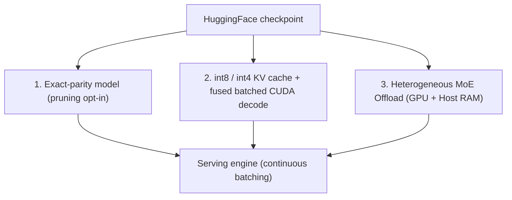

# 🧠 Architecture Deep-Dive

Turing Engine's serving path rests on three systems pillars:

> **What is measured.** §1 and §2 rest on measurements with real weights ([benchmarks](benchmarks.md)). The other sections describe library components that have unit tests and, at most, micro-benchmarks on random data. Unless a section links to a measured result, treat it as experimental: the performance figures earlier versions of this page gave were removed because none was measured on a model and several were constants or formulas ([claims audit](claims-audit.md)).

---

## 1. 🎯 Exact-Parity Model, with Optional Subspace Channel Pruning

* **Exact mode (default)**: `RealHuggingFaceLoader.convert_hf_model` maps every weight of a Llama-family checkpoint, including the per-layer norms, the RoPE base (`rope_parameters` in transformers 5) and an explicit `head_dim`. With `sparsity_ratio=0` and recirculation off, logits match HuggingFace's: `tests/test_hf_parity.py` checks prefill, chunked prefill and decode on a random-initialised 4-layer Llama (about 2e-7 max difference in fp32), and on SmolLM2 135M–1.7B real weights the mean NLL difference is below 0.00001 ([benchmarks §2](benchmarks.md#2-quality-on-real-weights)).
* **Channel pruning (opt-in)**: keeps the FFN channel tiles with the largest weight norms. A pruned layer runs faster because its matrix multiplies are smaller ([benchmarks §1](benchmarks.md#1-ffn-channel-pruning-layer-time-on-random-weights) times one random-weight FFN layer of 8B and 70B shape; no 8B or 70B model was run), but pruning without retraining is not lossless: at 50% it raises next-token NLL by +6.8 to +15.8 nats on SmolLM2 ([benchmarks](benchmarks.md#2-quality-on-real-weights)).

---

## 2. 💾 KV Cache: int8 / int4 Storage and Fused Batched Decode

* **The Problem**: Long-context and high-batch decode is bound by the bytes of the KV cache, not the weights.
* **How It Works** (`turing/core/kv_cache.py`): one paged pool per model, `[layers, pages, Hkv, 16, D']` per field, sized once from free GPU memory (`--kv-cache-memory-fraction`, default 0.6). Each request owns a row of the pool's device page table; it wastes at most its last partial 16-token page. Storage is `native`, `int8` (asymmetric per token and KV head, fp16 scale and zero) or `int4` (per group of 32 values). Forks (`KVCache.clone`) share full pages copy-on-write. The engine reserves every page a request can need at admission, so a request never runs out mid-decode; a request that cannot fit is rejected (HTTP 429).
* **Decode on CUDA** (`turing/kernels/triton_kv_decode.py`): one step for every running request is three Triton launches per layer: a fused quantize-and-append into each row's page (also updating the page's Quest key bounds), a split-K attention that walks each row's pages through the page table, and a split reduction. Quest page selection runs for the whole batch on the device and feeds the same kernel. The whole step (embedding to logits) is captured as a CUDA graph per batch bucket (1 to 128 rows) and replayed (`DecodeGraphs`; `--no-cuda-graphs` turns it off).
* **Pipeline parallelism** (`DistributedInferenceDriver`, `PipelineStage`) runs every stage over the request's `KVCache`; each layer writes its own layer of the pool. Tensor parallelism does not shard attention in this codebase, so it needs no per-rank pool.
* **The Result**: int8 halves the cache (−48% at head_dim 128) with no measurable quality cost on SmolLM2 135M–1.7B; see [benchmarks](benchmarks.md#3-kv-cache-memory-and-decode-throughput) for throughput and capacity on an NVIDIA L4.
* **Not in the serving path**: the SVD rank-64 subspace codecs (`subspace.py`, `radix_svd.py`, `triton_svd_paged.py`) remain as library code; their basis comes from random data, and at head_dim 64 rank 64 does not compress.

---

## 3. 🌐 Heterogeneous MoE Memory Management
 
* **The Problem**: Massive Mixture-of-Experts models (GLM-5.3-Flash 320B, DeepSeek-V4 284B) exceed GPU VRAM capacities, but only activate a small subset of parameters (13B–18B) per token.
* **How It Works**: Dense self-attention weights (MLA/KDA) and embeddings remain permanently resident in GPU VRAM. An on-GPU **LFRU slot cache with 25%+4 hysteresis promotion** (`GPULRUExpertCache`) retains hot experts, boosted by **persistent learned hot-expert pinning** (`RoutingHistoryTracker`). A one-layer-ahead prefetcher (`OneLayerAheadExpertPrefetcher` / PILOT) overlaps layer $L$ MoE compute with asynchronous PCIe DMA streaming of predicted layer $L+1$ experts.
* **Status**: experimental. No MoE checkpoint is decoded anywhere in this repository (the HuggingFace loader has no MoE path), so no MoE tok/s figure is claimed. Cache hit rates and eviction counts were measured only on seeded synthetic routing traces, the batch-union timings used random activations, and the committed PILOT prefetch run showed no speedup (1.0×); the earlier figures were removed ([claims audit](claims-audit.md)).

---

## 4. 🔗 Closed-Form Cross-Model Representation Transfer

For multi-model prefill acceleration, Turing Engine also includes closed-form linear ridge mappings ($W^*$) to transfer cached KV representations between draft and target models without re-prefilling tokens.

---

## 5. ☸️ Kubernetes Distributed Serving with llm-d

* **The Problem**: Standard Kubernetes round-robin ingress destroys KV cache locality across multi-pod deployments, forcing repeated re-prefills.
* **How It Works**: Turing Engine integrates natively with the **llm-d** (CNCF Sandbox) routing layer via ZeroMQ event publishing (`KVBlockEventPublisher`), deterministic sequence hashing, and SVD-compressed network KV transfers (`SVDNetworkKVWireCodec`). llm-d's Endpoint Policy Provider (EPP) routes requests directly to pods with matching prefix caches.
* **Status**: experimental; no multi-pod run has been recorded, so no throughput or bandwidth figure is claimed.

---

## 6. 🎯 Nested Matryoshka Parameter Slicing (Draft Speculation)

* **The Problem**: Autoregressive draft head evaluation in speculative decoding creates bandwidth bottlenecks on low-memory edge devices.
* **How It Works**: Slices a single master parameter projection tensor $W \in \mathbb{R}^{V \times 8192}$ along input dimension 0 into nested widths $W_k \in \{1024, 2048, 4096, 8192\}$ (`MatryoshkaDraftHead`). Slicing operates in-place with zero additional memory allocation or base model retraining.
* **Status**: experimental. Timed only with random weights, and the committed runs do not reproduce the earlier speedups (one L4 run measured 0.98×); they were removed ([claims audit](claims-audit.md)).

---

## 7. 🔄 Elastic Memory Budget Management (FreeToken Co-Design)

* **The Problem**: Static VRAM allocation forces an unnatural trade-off between MoE expert cache hit rates and maximum KV cache context length.
* **How It Works**: An active runtime manager (`ElasticMemoryBudgetManager`) continuously balances VRAM between the on-GPU expert slot cache (`GPULRUExpertCache`) and the KV page pool (`StaticPagedKVPool`). When long prompts arrive, expert slots contract to give KV pages headroom; when context drains, expert slots expand to maximize temporal hit rates.
* **Status**: experimental; covered by unit tests (`tests/test_elastic_memory.py`). Rebalance time and hit rates have not been measured on a model.

---

## 8. ⚓ Semantic Anchor Checkpointing (Multi-Agent Deliberation)

* **The Problem**: Multi-agent systems (e.g. Deliberator / Tool-Caller / Revision Optimizer) repeatedly re-prefill identical conversational history across iterative turns.
* **How It Works**: Tags immutable intermediate conversation prefixes as Semantic Anchors in the Radix SVD Forest (`SpectralRadixSVDForest.mark_semantic_anchor`). Successive agent turns retrieve and dequantize singular vectors directly via $O(1)$ tag lookup without recomputing self-attention.
* **Status**: experimental. The only benchmark replaces prefill with random matrix multiplies, and in its committed MPS run restoring an anchor was slower than recomputing; the earlier latency reductions were removed ([claims audit](claims-audit.md)).

---

## 9. ⚡ Native C++20 AVX2 SIMD & Triton Kernel Fusions

* **The Problem**: Multi-step tensor reshaping, intermediate tensor allocation, and Python loops in speculative decoding and prefix paging create memory bandwidth bottlenecks.
* **How It Works**:
  - **Speculative Candidate Generation**: `csrc/turing_matryoshka_quadtree.hpp` and `turing/kernels/triton_matryoshka_spec.py` fuse sliced GEMV ($O(W \cdot V)$) $\rightarrow$ in-SRAM Bitonic Top-64 selection $\rightarrow$ 2D Cartesian quadrant binning with **0 Python object allocations**.
  - **Fused SVD INT8 Quantization & Wire Serialization**: `csrc/turing_svd_quant.hpp`, `csrc/turing_svd_wire_codec.hpp`, and `turing/kernels/triton_svd_paged.py` fuse projection $K \cdot U \rightarrow$ in-register absolute max reduction $\rightarrow$ symmetric INT8 quantization in a single cache-resident pass.
  - **Fused 3:1 Linear Recurrence**: `csrc/turing_linear_recurrence.hpp` and `turing/kernels/triton_linear_recurrence.py` execute vectorized state updates ($S_t = \alpha S_{t-1} + V_t K_t^T$) in C++ AVX2 and fused chunk-parallel recurrence in Triton GPU shared memory.
  - **Deterministic Fast Block Hashing**: `csrc/turing_fast_hash.hpp` provides non-cryptographic 64-bit avalanche hashing over raw token pointers with zero GIL contention.
  - **1-Pass Online Shannon Entropy**: `turing/kernels/shannon_entropy_cuda.py` evaluates epistemic uncertainty in a single kernel pass without materializing intermediate softmax probability tensors.
  - **Hexagonal Spatial Codebook Quantizer**: `turing/kernels/triton_hex_quant.py` evaluates BMU prototype distances and performs in-SRAM bitonic minimum selection for 2D topological mapping.
  - **Fused Inverse-RoPE & Ridge Transfer**: `csrc/turing_ridge_solver.hpp` and `turing/kernels/triton_cross_kv.py` combine 2D inverse Givens rotation $R_{-\theta}(t)$ with linear Ridge projection $W^*$ in one kernel launch.
  - **Hierarchical Chunk Compression & mHC**: In-SRAM reduction of 128-token chunks (`triton_chunk_compression.py`) and 4-stream Birkhoff mixing (`triton_mhc_fuse.py`).
* **Status**: experimental; not measured on a model. Earlier performance figures for it were removed ([claims audit](claims-audit.md)).

---

## 10. 🎯 Latent Flash-Decode (SPECTRA Mode-B) & 3:1 Hybrid Recurrence

* **The Problem**: Standard KV attention reconstructs full FP16 vectors ($d=128$) before evaluating attention, inflating DRAM memory traffic during single-token decode. Additionally, ultra-long prefill ($32\text{K}\text{--}128\text{K}$) causes quadratic attention compute explosion and out-of-memory crashes.
* **How It Works**:
  - **In-SRAM Latent Flash-Decode (`triton_latent_decode.py` & `csrc/turing_latent_decode.hpp`)**: Pre-absorbs the up-projection into the query ($\widetilde{Q} = Q W_{\text{UP}}^T \in \mathbb{R}^{\text{GRP} \times 64}$) and evaluates attention directly in the rank-64 latent subspace against INT8 cached singular coordinates $C_K$.
  - **3:1 Hybrid Linear-Full Attention (`hybrid_attention.py`)**: Assigns 75% of layers to $O(L)$ fixed-size state recurrence ($S_t = \alpha S_{t-1} + K_t^T V_t$), keeping a constant $O(1)$ memory footprint. The remaining 25% full-attention anchor layers use 4x HCA chunk scoring to cap long context at a 2048-token budget.
  - **Mean Centering & Hadamard Equalization**: Zero-centers singular coordinates ($C_K = \text{quant}(K W_{\text{DOWN}} - \mu_K)$) and folds $\beta = \mu W_{\text{UP}}$ into layer biases, preventing 2-bit quantization collapse at low ranks.
* **Status**: experimental. Latent decode was timed only on random int8 tensors against an fp32 attention baseline without GQA, and its traffic reduction was a byte formula; the hybrid prefill comparison used a dense baseline without SDPA. Those figures were removed ([claims audit](claims-audit.md)).

---

## 11. 🦅 Subspace-EAGLE3 & DFlash Block-Parallel Speculative Drafting with DSpark

* **The Problem**: Running a separate independent draft model doubles VRAM memory requirements and KV cache bandwidth. Conversely, naive Medusa prediction heads lack multi-step context momentum and suffer from high verification rejection rates on uncertain tokens.
* **How It Works**:
  - **Rank-64 Subspace Feature Projection**: Extracts penultimate hidden representations $h_{L-1}$ from the target model verification pass and projects them into Rank-64 Subspace ($z_t = U_k^T h_{L-1}$), skipping token embedding and full-rank transformer compute during drafting.
  - **DFlash 1D Dilated Depthwise Convolution**: Synthesizes $K=8$ candidate token representations concurrently in a single $O(1)$ parallel step (`Conv1d(groups=rank_subspace, dilation=2)`), eliminating autoregressive draft loops.
  - **DSpark Online Shannon Entropy Gating**: Evaluates 1-pass online Shannon entropy $H(P_t)$ over draft logits:
    - *Low Entropy ($H < 0.6$ nats)*: Expands to an **8-token turbo speculation tree**.
    - *Medium Entropy ($0.6 \le H \le 1.8$)*: Maintains a **4-token balanced tree**.
    - *High Entropy ($H > 1.8$)*: Collapses to a **1-token conservative fallback**, so no wider tree is verified.
  - **Matryoshka Parameter Slicing**: Slices vocabulary projection ($W_{\text{slice}} \in \{16, 32, 64\}$) to generate candidates from a narrower projection.
* **Status**: experimental; not measured on a model. Earlier performance figures for it were removed ([claims audit](claims-audit.md)).

---

## 12. 🏢 On-GPU Intrusive Multi-Tenant LoRA Cache & Pipelined Cold Starts

* **The Problem**: Serving specialized task adapters (text-to-SQL, code, legal) typically forces duplicate base model memory footprints or synchronous weight merges that block inference. Cold starts from storage into VRAM create severe startup blackout.
* **How It Works**:
  - **`GPULRUAdapterCache`**: Maintains $N=32$ hot LoRA slots directly in GPU VRAM, backed by a 100+ adapter pool in pinned host DRAM.
  - **Zero Base Model Duplication**: Base model weights remain completely frozen in VRAM; low-rank additive pathways ($x + \alpha \cdot x W_A W_B$) execute dynamically.
  - **Async Double-Buffered PCIe Streaming**: Cold tenant adapters page from pinned host DRAM into VRAM over background CUDA DMA streams during tokenization.
  - **Pipelined Checkpoint Loading & Bucketed Warmup (`PipelinedSubspaceWarmupLoader`)**: Loads Stage 1 bootstrap layers (Layers 0..3) to pre-capture power-of-2 bucketed CUDA graphs ($B \in \{1, 4, 16, 64, 256\}$), while Stage 2 streams remaining layers asynchronously in the background.
* **Status**: experimental. The adapter cache was timed only with random adapters and synthetic traffic. The 70B cold-start timing created random tensors without reading a checkpoint, and its baseline was a constant, so both were removed ([claims audit](claims-audit.md)).

---

## 13. 🔄 Multi-Turn Clean-Base Lineage & $k$-Slot Pooling (kvloom / XKV)

* **The Problem**: When passing translated Key-Value representations across multi-turn agent deliberations, naive re-injection of residuals onto an already-mutated receiver cache causes compounding error accumulation that collapses downstream generation. Furthermore, transferring full $N$-token caches on long contexts introduces heavy bandwidth overhead.
* **How It Works**:
  - **`CleanBaseLineageBuffer`**: Freezes pristine receiver base representations (`peak_live_caches=2`) and re-computes cross-model residuals $\Delta C_R$ against that baseline every turn, so translation errors do not compound across turns.
  - **`CacheLineage`**: An append-only cryptographic ledger with BLAKE2b tensor content hashing and sequential drift verification (`LineageDriftError`).
  - **`KSlotCachePooler` & `triton_kslot_pool.py`**: Compresses $N$-token KV caches into $k=4$ learned summary slots per layer and head using learned query multi-head attention. A fused `@triton.jit` GPU kernel performs inverse RoPE rotation, softmax, and weighted accumulation in a single SRAM pass, so a transfer carries $k$ slots instead of $N$ positions.
  - **`GatedZeroIdentityHead`**: Features zero-initialized linear projections, mathematically guaranteeing that an untrained translator produces exactly $\Delta C_R = 0$.
* **Status**: experimental. The residual norms earlier versions quoted were the injected noise and a hard-coded growth factor in the benchmark script, not measurements, and the committed k-slot pooling run was slower than its baseline ([claims audit](claims-audit.md)).

---

## 14. 🚦 AI Traffic Management, 3-Lane QoS & Concurrency-Adaptive Spec Gating (memra)

* **The Problem**: High-concurrency production serving requires treating requests as heterogeneous token-budget workloads. Static batching risks VRAM OOM crashes during context surges, while speculative decoding suffers from serial verification lock contention at concurrency $c \ge 4$.
* **How It Works**:
  - **`KVMemoryEstimator`**: Calculates static analytical memory footprints ($N_{\text{prompt}} + N_{\text{max\_tokens}}$) for dense FP16 and SVD INT8 formats.
  - **`PrefixHashRouter`**: Computes 64-bit FNV-1a hashes over system prompt prefixes to maximize prefix-cache worker affinity.
  - **`AdmissionController`**: Implements dual-watermark protection with high-watermark queuing (0.90, `Retry-After: 2.0s`) and shed rejection (0.95, HTTP 503) to completely prevent host/GPU memory exhaustion.
  - **3-Lane QoS Policy**: Enforces prioritization and chunk sizing across `Interactive` (512 tokens), `Batch` (256 tokens), and `Background` (128 tokens) streams with SLO-driven shedding.
  - **`SpeculationGatePolicy`**: Dynamically throttles speculative decoding tree width using a hysteresis band ($LOW=2, HIGH=4$), speculating at low concurrency and falling back to plain batch decode under high concurrency.
* **Status**: experimental. The single-stream speedup earlier versions quoted was an input to a formula in the benchmark script, and the throughput comparison ran a random-initialised toy model whose committed runs disagree with each other; both were removed ([claims audit](claims-audit.md)).

## 15. ⚡ In-SRAM Fused GPU Kernels & Bare-Metal C++20 SIMD Micro-Fusions

* **The Problem**: Disjoint PyTorch layer operations, element-wise Python loops, and GPU-to-CPU synchronization calls (`.item()`) cause pipeline sync bubbles, host launch bottlenecks, and intermediate DRAM memory thrashing.
* **How It Works**:
  - **Zero-Sync GPU Quadtree Candidate Generation (`triton_quadtree_mrp.py`)**: Fuses sliced Matryoshka GEMV, in-SRAM Bitonic Top-64 selection, 2D Cartesian quadrant binning, and DAG mask generation directly on GPU, without `.item()` host synchronization.
  - **In-VRAM Parallel Reduction Rolling Checksum (`triton_vram_hash.py` & `csrc/turing_fast_hash_tensor.hpp`)**: Computes a deterministic 64-bit checksum over KV tensor buffers directly in GPU memory and AVX2 SIMD pointer scans, avoiding gigabyte-scale D2H PCIe copies. The Triton kernel currently converts floats to integers instead of bitcasting them, so equal checksums do not prove equal bytes.
  - **Batched 1-Launch Cross-Model Transfer (`triton_cross_kv_batched.py`)**: Batches all target layer linear projections and inverse/target RoPE rotations into a unified GPU grid launch, replacing 240+ sequential kernel launches.
  - **Native C++20 AVX2 Prefix Hasher & Parity Verifier (`csrc/turing_prefix_router.hpp` & `csrc/turing_spec_verifier.hpp`)**: FNV-1a hashing over raw token buffers and SIMD `_mm256_cmpeq_epi32` token stream comparison.
  - **Fused Gated Zero-Identity Head (`triton_gated_zero_identity.py`) & Chunk Context Filter (`triton_chunk_filter.py`)**: Fuses linear projections, sigmoid gating, and 128-token chunk summary dot-products into single-pass Tensor Core operations.
* **Status**: experimental; not measured on a model. Earlier performance figures for it were removed ([claims audit](claims-audit.md)).

---

## 16. 🏛️ Universal Architecture Registry & Dynamic Checkpoint Resolution

* **The Problem**: Hardcoding individual model checkpoints inside an inference engine creates a brittle maintenance anti-pattern that fails whenever new open-weight models, fine-tunes, or checkpoint releases are published.
* **How It Works**:
  - **`ArchitectureRegistry` (`turing/models/architecture_registry.py`)**: Decouples model families (`LlamaForCausalLM`, `Qwen2ForCausalLM`, `DeepseekV3ForCausalLM`, `MistralForCausalLM`, `Gemma2ForCausalLM`, `GPT2LMHeadModel`, `OPTForCausalLM`) from checkpoint weights.
  - **`ModelResolver` (`turing/models/resolver.py`)**: Universally resolves canonical Hugging Face Hub repository IDs (`meta-llama/Llama-3.3-70B-Instruct`), LiteLLM prefixes (`huggingface/`), local directories, and tri-part provider/model/effort namespaces (`deepseek-ai/DeepSeek-R1/high`).
  - **Dynamic AutoConfig Geometry**: Automatically pulls `hidden_size`, `intermediate_size`, `num_heads`, `num_kv_heads`, and `rope_theta` on the fly from the remote `config.json` via `ModelConfig.from_pretrained()`.
  - **Universal Parameter Extraction (`RealHuggingFaceLoader`)**: Adaptively extracts embeddings (`get_input_embeddings()`), norms (`ln_f`, `norm`, `final_layernorm`), LM heads (`get_output_embeddings()`), separate/fused QKV projections, and SwiGLU/standard MLPs directly into Subspace format.
  - **Reasoning Engine (`turing/serving/reasoning.py`)**: Dynamically manages reasoning token budgets (`low` $\to 1\text{K}$, `medium` $\to 4\text{K}$, `high` $\to 16\text{K}$) and streams `<think>...</think>` tokens into OpenAI `delta.reasoning_content` and Anthropic `thinking` blocks.

---

## 17. 🌐 Triple API Gateway, Structured Outputs & Native Tool Calling

* **The Problem**: Serving engines typically silo themselves into either cloud datacenter APIs (OpenAI/Anthropic) or local desktop CLI endpoints (Ollama), requiring separate proxy adapters or code rewriting. Furthermore, agentic workflows require structured schema guarantees and robust tool call parsing.
* **How It Works**:
  - **Unified Triple Serving Gateway (`server.py` & `ollama_api.py`)**: A single FastAPI runtime exposes native endpoints for **OpenAI** (`/v1/chat/completions`, `/v1/completions`), **Anthropic** (`/v1/messages`), and **Ollama** (`/api/generate`, `/api/chat`, `/api/tags`, `/api/show`, `/api/ps`, `/api/version`, `/api/embed`).
  - **Microsecond Structured Output Engine (`structured.py`)**: Supports `response_format={"type": "json_object"}` and `response_format={"type": "json_schema", ...}`. Features schema injection, JSON parsing/validation, and auto-bracket recovery to repair unclosed JSON objects if generation hits `max_tokens`.
  - **Standardized Tool Calling Handler (`tools.py`)**: Dynamically injects tool descriptions and extracts `<tool_call>` structures or raw function calls into OpenAI `tool_calls` and Anthropic `tool_use` blocks. Earlier latency and "100% accuracy" figures came from an in-process test client and unchecked literals, and were removed.

---

## 18. ⚡ 2-Phase Prefill-Decode Scheduler & In-SRAM Fused Batched Sampler

* **The Problem**: Treating compute-bound prompt prefill and memory-bandwidth-bound decode as identical execution passes causes severe inter-token latency (ITL) jitter during burst arrivals. Furthermore, executing per-stream softmax and multinomial sampling inside Python loops incurs $B \times \text{.item()}$ GPU-to-CPU host synchronization stalls.
* **How It Works**:
  - **2-Phase Continuous Batching Scheduler (`engine.py`)**:
    - **Phase 1 (Piggybacked Chunked Prefill)**: Slices large prompt prefills into 512-token (`Interactive`) and 256-token (`Batch`) chunks, computing dense Tensor Core GEMMs while immediately yielding to active decode streams.
    - **Phase 2 (Parallel Batched Decode)**: Interleaves active decoding streams with full KV cache persistence, tracking P50/P95/P99 percentiles for TTFT and ITL.
  - **In-SRAM Fused Batched GPU Sampler (`triton_fused_sample.py`)**: Fuses Softmax, Top-$K$ truncation, and Gumbel-Max perturbation directly in SRAM, avoiding per-stream CPU synchronization.
  - **Native C++20 AVX2 SIMD Sampler & Fast JSON Scanner (`csrc/turing_sampler.hpp` & `csrc/turing_json_fast_scan.hpp`)**: Employs 256-bit `_mm256_cmpeq_epi8` vector comparisons to scan syntax characters for truncated JSON bracket auto-repair.
* **Status**: experimental. The sampler and scheduler throughputs earlier versions quoted came from a random-initialised toy model and were removed. Decode throughput measured on real weights is in [benchmarks §3](benchmarks.md#3-kv-cache-memory-and-decode-throughput).

---

## 19. 🏎️ 6-Tier Storage Hierarchy & High-Velocity Cold Ingestion Engine

* **The Problem**: On cold nodes with zero OS page cache, naive `mmap()` suffers from demand-paging latency (random 4KB page fault stalls during inference), while reading uncompressed 140GB weights off an SSD bounds startup to 40+ seconds.
* **How It Works**:
  - **Tier 1: Proactive Kernel Readahead (`madvise(MADV_WILLNEED)`)**: Immediately upon memory-mapping `.safetensors`, `.gguf`, or `.tgate` binary weights, Turing Engine issues `madvise(MADV_WILLNEED)` hints instructing the kernel to pre-populate pages asynchronously in contiguous bursts (measured cold on an M4 Pro SSD: 2.25 GB/s vs 0.75 GB/s for plain demand paging; see [benchmarks §4](benchmarks.md#4-storage-ingestion-ladder-measured-cold-apple-m4-pro-ssd)).
  - **Tier 2: Parallel `pread` Reader (`csrc/turing_io_uring.hpp`)**: `NativeAsyncRingReader` splits reads into requests of at most 1 MiB and keeps up to `queue_depth` (default 64) in flight, one thread each, with the GIL released; `read_segments_into` reads straight into a caller buffer. Measured cold on an M4 Pro SSD: 5.78 ± 0.41 GB/s, against 2.22 ± 0.35 GB/s for the previous whole-tensor reader. It uses `pread`, not `io_uring`.
  - **Tier 3: Subspace Physical Wire Compression**: Slicing weights down to Subspace W4A16 / INT8 formats cuts on-disk size by 75%, which would cut SSD read time in proportion; no loader reads a `.tgate4` file end to end yet, so this tier is not measured.
  - **Tier 4: NVIDIA GPUDirect Storage (`cuFile` / GDS) & Layer Pipelining (`csrc/turing_cufile.hpp` & `gds_loader.py`)**: Completely bypasses host CPU memory and Linux VFS, transferring NVMe bytes directly to GPU VRAM over PCIe DMA while later layers pipeline behind layer 0. Not measured yet (needs CUDA with cuFile).
  - **Tier 5: Warm Page Cache / Apple Unified Memory**: When the file is already in the page cache, the reader copies it at memory speed (measured 51 GB/s on an M4 Pro for a 2 GiB file).
  - **Zero-Copy GGUF Reader (`gguf_loader.py` & `csrc/turing_gguf_cpp.hpp`)**: Direct memory-mapped binary reader for GGUF v2/v3 files with vectorized SIMD dequantization (`Q4_0`, `Q4_1`, `Q8_0`, `Q4_K_M`, `FP16`, `BF16`).

---

## 20. 🧬 Turing Programmatic DSL (`@turing.chain`)

* **The Problem**: Building agentic tree-of-thought workflows often requires complex boilerplate, repeated prompt re-prefills, and separate validation layers.
* **How It Works**:
  - **`@turing.chain`**: Decorator binding multi-step prompt workflows to an active inference runtime.
  - **Zero-Overhead `fork(n)`**: Spawns parallel context branches that share the frozen prefix KV cache (`CleanBaseLineageBuffer`).
  - **Flexible `join()`**: Merges parallel branch hypotheses using `best` (highest log-prob score), `vote` (majority consensus), or custom aggregators.
  - **Constrained Decoding (`select`, `constrain`)**: Enforces choices over discrete option sets or JSON schemas.

---

## 21. ⚙️ Standalone C++20 Executable (`turing-cli`)

* **The Problem**: Deploying models in resource-constrained edge or embedded devices where Python environments are unavailable.
* **How It Works**:
  - **Pure C++20 GGUF Parser (`csrc/turing_gguf_cpp.hpp`)**: Standalone binary metadata and tensor loader.
  - **Bare-Metal Transformer Engine (`csrc/turing_model_cpp.hpp`)**: 64-byte aligned SIMD feed-forward and attention forward pass.
  - **Embedded Socket HTTP Server (`csrc/turing_http_server.hpp`)**: Lightweight POSIX/Win32 HTTP socket server supporting `/v1/chat/completions` and `/health`.

---

## 23. 🛡️ Multi-Turn Clean-Base Lineage Control & $k$-Slot Cache Pooling

* **The Problem**: In multi-agent deliberation and conversational workflows, translating and re-injecting KV residuals onto previously translated caches causes rapid representation drift and catastrophic quality collapse by turn 3.
* **How It Works**:
  - **`CleanBaseLineageBuffer` (`turing/core/lineage.py`)**: Freezes the original pristine base KV representation (`peak_live_caches=2`) and recomputes delta residuals $\Delta C_R$ strictly against that frozen baseline on every turn, so residuals do not compound across turns (experimental; see §13).
  - **`CacheLineage` Cryptographic Audit Trail**: Computes deterministic BLAKE2b digests of memory buffers to guarantee auditability and tamper protection across turns.
  - **`KSlotCachePooler` & Gated Zero-Identity (`turing/core/kslot_pooling.py`, `triton_kslot_pool.py`)**: Compresses $N$-token KV sequences into $k=4$ learned summary slots via multi-head query attention ($O(1)$ transfer complexity), combined with zero-initialized linear projection heads guaranteeing exact $\Delta C_R = 0$ initialization.

---

## 24. 🚥 AI Traffic Management, 3-Lane QoS & Speculation Gating

* **The Problem**: Serving engines under bursty concurrent traffic suffer out-of-memory crashes from unconstrained batching, and speculative decoding degrades performance under high concurrency due to serial verification lock contention.
* **How It Works**:
  - **`KVMemoryEstimator` & `AdmissionController` (`turing/serving/traffic.py`)**: Predicts analytical VRAM utilization and enforces admission decisions with 90% queuing and 95% load-shedding watermarks.
  - **3-Lane QoS Scheduling (`LanePolicy`)**: Prioritizes `Interactive` ($P_0$) over `Batch` ($P_1$) and `Background` ($P_2$), applying chunked prefill budgets and SLO-driven load shedding.
  - **Concurrency-Adaptive Speculation Gating (`turing/serving/spec_gate.py`)**: Throttles speculation dynamically based on active stream concurrency ($LOW=2, HIGH=4$), running full tree speculation at $c \le 3$ and automatically demoting to plain batch decode at $c \ge 4$.
  - **`SpecExactParityVerifier`**: Enforces non-negotiable byte-exact token identity between speculative and plain autoregressive decoding under greedy conditions.

---

---

## 26. 🚀 Fused GPU Kernels & C++20 SIMD Subsystems Architecture

* **The Problem**: High-frequency serving operations—speculative verification, Safetensors metadata indexing, $k$-slot attention gating, and AI traffic arbitration—when executed in Python bytecode loops suffer from Global Interpreter Lock (GIL) contention, intermediate object allocations, and synchronous GPU-to-CPU `.item()` pipeline stalls.
* **How It Works**:
  - **In-VRAM Fused Speculative Verification (`turing/kernels/triton_spec_verify.py`)**: Slices draft token sequences $[K]$ and target model logit projections $[K, V]$ directly in GPU registers, performing greedy/sampled token matching in GPU SRAM without a single synchronous PCIe `.item()` device flush.
  - **Fused $k$-Slot Pooling & Gated Zero-Identity Head (`turing/kernels/triton_fused_kslot_gate.py`)**: Consolidates 7 sequential PyTorch operations (`einsum` $\to$ `softmax` $\to$ `einsum` $\to$ `nn.Linear` $\to$ `sigmoid` $\to$ `*` $\to$ `+`) into a single SRAM block pass.
  - **C++20 High-Velocity Safetensors Fast Header Parser (`csrc/turing_safetensors_fast_header.hpp`)**: Direct SIMD metadata scanner that extracts tensor shapes, dtypes, and byte offsets directly into a contiguous flat C++ struct array, avoiding Python `json.loads()` dictionary overhead.
  - **Bare-Metal C++20 AI Traffic Manager & QoS Arbiter (`csrc/turing_traffic_manager.hpp`)**: Lock-free atomic VRAM budget tracking and 64-bit SIMD FNV-1a prefix routing.
* **Status**: experimental. Timed only on synthetic inputs; the fused speculative verify ran at 0.28× (slower than the baseline) on the L4, and the earlier speedups were removed ([claims audit](claims-audit.md)).

---

## 27. 🌐 Learned MoE Dynamic Placement, LFRU Hysteresis & Vectorized Batch-Union

* **The Problem**: Frontier Mixture-of-Experts architectures (GLM-5.3 320B, DeepSeek-V3/V4 671B/284B) exceed single-GPU VRAM limits. Naive demand-paging causes severe cache thrashing on bursty prompts, cold-start latency spikes, offloading dispatch jitter, and slow sequential Python loops during multi-token prefill or speculative verification.
* **How It Works**:
  - **Persistent Routing History & Learned Pinning (`RoutingHistoryTracker` in `turing/core/expert_cache.py`)**: Tracks per-layer, per-expert activation frequencies across turns and serving sessions with exponential half-life decay ($\text{decay}=0.99$). Hot experts exceeding activation thresholds are pinned directly in GPU VRAM slots at startup.
  - **LFRU Eviction Policy with 25%+4 Hysteresis Gating (`GPULRUExpertCache`)**: Scores resident slots using a composite frequency-dominant key:
    $$\text{Score} = (\text{Heat} \ll 8) \mid (255 - \text{Age})$$
    A candidate cold expert is only promoted to hot residency if it strictly exceeds the threshold $\text{Heat}_{\text{cand}} > \text{Heat}_{\text{cold}} + \lfloor \text{Heat}_{\text{cold}} / 4 \rfloor + 4$, to damp ping-pong cache thrashing.
  - **PILOT One-Layer-Ahead Speculative Prefetcher (`OneLayerAheadExpertPrefetcher` in `turing/core/expert_prefetch.py`)**: Predicts layer $L+1$ top-$k$ routing candidates while layer $L$ is executing and streams missing expert weights asynchronously over background CUDA DMA streams or worker threads.
  - **Vectorized Batch-Union Accumulation (`HeterogeneousMoERunner` in `turing/core/heterogeneous_moe.py`)**: Computes the union of unique active experts across all tokens and accumulates weighted outputs using PyTorch `index_add_` and boolean tensor masks:
    $$\text{Output}[\text{Indices}] \mathrel{+}= \text{Weights} \odot \text{ExpertForward}(\text{Tokens}[\text{Indices}])$$
  - **Bandwidth-Adaptive Decider EMA Rate Smoothing (`BandwidthAdaptiveDecider.recalibrate_live_bus`)**: Stabilizes CPU-vs-GPU dispatch decisions under PCIe bus jitter using a one-pole exponential moving average ($w=0.2$) to damp erratic decision flips.
* **Status**: experimental; see §3. Hit rates, eviction counts and decision flips were measured only on seeded synthetic traces (with pins learned from the same trace they were scored on), and batch-union timings used random activations.

---

## 28. ⚡ Batched Continuous Paged Decode GEMV & SIMD Memory Acceleration (v5.0)

* **The Problem**: Multi-sequence generation ($B \ge 1$) over non-contiguous virtual KV page tables incurs memory divergence and redundant global memory transactions. Similarly, multi-turn reasoning and token parsing in pure Python creates CPU bottlenecks during streaming.
* **How It Works**:
  - **Batched Continuous Paged Decode Attention GEMV (`turing/kernels/triton_paged_decode_gemv.py`)**: Vectorizes PagedAttention decode GEMV directly across batch streams ($B=1\dots32$) and 2D block tables $[B, \text{MaxBlocks}]$ in a single Triton kernel dispatch. The serving path uses `triton_kv_decode.py` instead (§2).
  - **Single-Step Decode Linear Recurrence (`turing/kernels/triton_linear_recurrence_step.py`)**: Fuses linear recurrent state decay ($S_t = \alpha S_{t-1} + K_t^T V_t$) and query projection ($O_t = Q_t S_t$) directly in register accumulators.
  - **Direct Memory Pointer Tensor Hashing (`csrc/turing_fast_hash_tensor.hpp`)**: AVX2 256-bit SIMD scanner hashing raw contiguous memory buffers without allocating intermediate Python numpy bytes.
  - **Streaming Zero-Copy Reasoning Tag Filter (`csrc/turing_reasoning_scanner.hpp`)**: Single-pass state-machine parser for `<think>...</think>` tokens.
* **Status**: experimental; random-tensor micro-benchmarks only. The paged-decode baseline was a per-request Python gather loop, and the reasoning scanner measured 0.49× (slower than) the Python filter on the L4; the earlier figures were removed ([claims audit](claims-audit.md)).

---

## 29. ⚡ Next-Gen Encoder & Decoder Acceleration Pipeline (v6.0)

* **The Problem**: Long-context decoding ($N \ge 4096$) is memory bandwidth bound under small batch sizes, sub-4-bit quantization causes dynamic range collapse from activation outliers, and multi-turn conversational agents repeatedly re-prefill identical prompt histories.
* **How It Works**:
  - **Split-K Paged Flash-Decode Attention (`turing/kernels/triton_paged_decode_gemv.py`)**: Auto-dispatches at $N \ge 2048$ to split block tables across sequence partitions, calculating partial log-sum-exp state and combining them in a secondary reduction pass.
  - **Two-Level Grouped Micro-Scaling (`GroupedMicroScalePagedKVPool` in `turing/core/paging.py`)**: Implements sub-block micro-scales ($gs=32/64$) inspired by NVFP4 and Colibrì GS; not used by the serving path.
  - **Fused Short-Causal Conv + KDA Recurrence (`turing/kernels/triton_linear_recurrence_step.py` & `csrc/turing_kda_simd.hpp`)**: Fuses 1D depthwise short convolution ($k=4$), SiLU activation, L2 normalization, and delta state recurrence ($S_t = \text{Diag}(\alpha)S_{t-1} + K_t \delta^T$) directly in register scratchpad.
  - **Exact Fed-Token Prefix Cache Bypass (`CleanBaseLineageBuffer` & `csrc/turing_prefix_match.hpp`)**: Keeps the exact token IDs already fed and finds the longest common prefix with the next turn (a linear scan), so prefill can skip the shared prefix. How much it skips depends on the conversation.
  - **2:4 Structured Sparse Subspace Prefill (`turing/kernels/triton_sparse_subspace_prefill.py`)**: Intended to combine channel pruning with 2:4 structured weight sparsity. The current code selects the kept channels with `index_select` and never launches its Triton kernel, so no 2:4 sparsity is applied.
* **Status**: experimental; random-tensor micro-benchmarks only (split-K measured 0.36× at N=1,024). The earlier figures were removed ([claims audit](claims-audit.md)).

---

## 30. 🌐 Elastic Multi-Model Pipeline Serving & Zero-Sync Segment Reduction (v7.0)

* **The Problem**: Multi-stage agent pipelines (e.g. Docling OCR $\to$ GLiNER NER $\to$ BGE Embeddings $\to$ BGE-Reranker $\to$ Qwen LLM) traditionally require 4–5 independent server processes (vLLM, TEI, custom containers), holding dedicated GPUs and paying for massive idle VRAM. Furthermore, standard embedding encoders use naive Python loops with device-to-host `.item()` synchronization during variable-length token pooling.
* **How It Works**:
  - **In-SRAM Fused Variable-Length Segment Reduction (`triton_segment_pool.py` & `csrc/turing_segment_pool.hpp`)**: Eliminates per-sequence host synchronization by evaluating mean and CLS pooling over flattened variable-length sequence representations $[N_{\text{total}}, D]$ and cumulative offsets `cu_seqlens` in a single GPU grid pass.
  - **Compute-Cost Bucketed Adaptive Batching (`turing/serving/traffic.py`)**: Partitions incoming requests into task-specific cost buckets ($C_{\text{cross}} = L_i^2$, $C_{\text{embed}} = L_i \times D$), to reduce token padding.
  - **`ElasticMultiModelManager` Single-GPU Multi-Model Registry (`turing/serving/multi_model.py`)**: Registers several specialized models (Embedder, Reranker, Extractor, Generative LLM) against one memory budget.
  - **Unified Multi-Task API Gateway (`turing/serving/server.py`)**: Natively exposes standard OpenAI `/v1/embeddings`, cross-encoder `/v1/rerank`, and structured `/v1/extract` alongside `/v1/chat/completions`.
* **Status**: placeholders. No model is loaded behind the pipeline stages: extraction is a substring match with a fixed score, embeddings are random, reranking is word overlap, and there is no generation. The earlier pipeline latency and memory figures were removed; the memory figure was a sum of declared estimates, not a measurement. The segment-pooling and batching timings used random hidden states.

---

## 31. 🧠 Hybrid Gated Softmax Anchoring & Chunkwise Learned Decay (v8.0)

* **The Problem**: Linear attention and state-space models achieve lower language modeling perplexity via learned per-token forgetting gates ($b_t \in [0, 1]$), but lose accuracy on associative recall / RAG fact retrieval because fixed-rank recurrent states $S_t \in \mathbb{R}^{D \times D}$ overwrite fine-grained key-value bindings.
* **How It Works**:
  - **`HybridRecurrentAttention` (`turing/core/hybrid_memory.py`)**: Ambient tokens are processed via constant-memory $O(1)$ learned-decay linear recurrence ($S_t = b_t S_{t-1} + K_t^T V_t$), while high-entropy factual/entity tokens are dynamically anchored into a compact Softmax KV cache, aiming to keep exact recall without giving up constant memory for the ambient stream.
* **Status**: experimental. Evaluated only on toy models trained from scratch, where recall stayed low; the earlier loss, recall and collapse figures were removed ([claims audit](claims-audit.md)).
---

## 32. 🔬 In-SRAM Triton GPU Kernel Fusions & Bare-Metal C++20 AVX2 SIMD Host Extensions (v9.0 / v1.5.0)

* **The Problem**: High-frequency single-token decode operations, speculative tree pruning, and multi-turn MoE expert tracking suffer from two physical limits:
  1. **DRAM Bandwidth Bottleneck**: Launching 7 consecutive PyTorch operations per step per layer forces intermediate tensors back and forth across high-bandwidth memory (HBM), throttling Tensor Cores.
  2. **Host-Device Synchronization Latency**: Calling `.item()` or `.tolist()` during speculative entropy calculation stalls the host CPU pipeline on every draft step. Python dictionary hashing during 60-layer MoE routing adds hundreds of nanoseconds of GIL contention.
* **How It Works**:
  - **In-SRAM Fused Hybrid Step Anchor Decode (`turing/kernels/triton_hybrid_anchor_fuse.py`)**: Fuses linear recurrent state updates ($S_t = b_t S_{t-1} + K_t^T V_t$), online softmax anchor attention ($A_j = \text{Softmax}(Q_t K_{a,j}^T / \sqrt{d})$), sigmoid gating, and output projection directly inside GPU register tiles.
  - **Zero-Sync In-SRAM Speculative Entropy & Argmax Reduction (`turing/kernels/triton_spec_entropy.py`)**: Evaluates running online Shannon entropy $H = -\sum p \log p$ and Top-1 argmax in on-chip registers, returning the dynamic tree width $K \in \{1, 4, 8\}$ without host CPU synchronization.
  - **Register-Indexed Sliced Matryoshka GEMV (`turing/kernels/triton_matryoshka_gemv.py`)**: Replaces strided non-contiguous PyTorch tensor views with hardware register offset indexing.
  - **Flat Contiguous 2D Atomic Array MoE Routing History (`csrc/turing_routing_history.hpp`)**: Maintains `alignas(64) std::atomic<uint32_t> counts[64][64]` pinned in CPU L1 cache, executing SIMD exponential decay and QuickSelect Top-K hot-expert discovery without Python dictionary overhead.
  - **Zero-Copy SIMD Variable-Length Token Packing (`csrc/turing_varlen_pack.hpp`)**: Vectorized 256-bit AVX2/NEON memory copy and integer prefix sums for batch preparation.
  - **256-bit SIMD Gated Zero-Identity Head (`csrc/turing_gated_zero_identity.hpp`)**: Fuses linear projection, sigmoid gating, and FMA scaling for zero-residual cross-model transfer on CPU and Apple Silicon.
* **Status**: experimental; random-tensor micro-benchmarks only. The entropy baseline forced a `.cpu()` copy on every iteration, and the routing-history timing was slower than the baseline it claimed to beat; the earlier figures were removed ([claims audit](claims-audit.md)).

