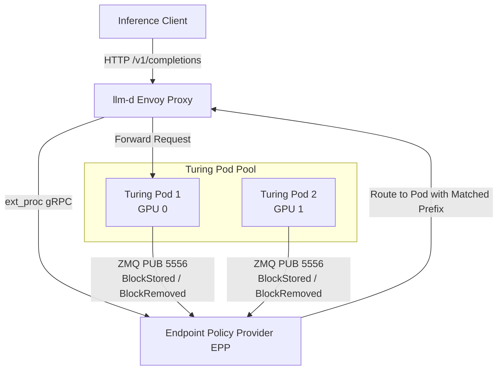

# Kubernetes Distributed Serving with llm-d

This guide explains how to deploy **Turing Engine** in a **Kubernetes** cluster orchestrated by [**llm-d**](https://llm-d.ai) for **prefix-cache aware routing** across replicas.

---

## 🎯 Architecture Overview



### How Prefix-Cache Aware Routing Works
1. **Prefix cache**: each Turing Engine pod keeps an automatic prefix cache over its paged KV pool. Every full
   16-token page of a finished prefill (and of a finished request) is indexed by a chained hash of its tokens, and
   later requests that start with the same tokens reuse those pages instead of recomputing them.
2. **KV events**: with `--enable-kv-events`, each pod publishes `BlockStored` (block hashes, parent hash, token ids,
   block size 16), `BlockRemoved` and `AllBlocksCleared` events on a ZeroMQ PUB socket (port 5556), in vLLM's
   msgpack KV-event format, on the topic `kv@<POD_IP>:<port>@<model>`. A ROUTER socket (port 5559) replays events
   from a sequence number for subscribers that reconnect.
3. **Routing**: llm-d's precise prefix-cache scorer indexes the blocks each pod holds and sends a request to the pod
   with the longest matching prefix. Tokens for its index come from the render endpoints below.

Prefill/decode disaggregation across pods is not part of this guide (see the serving guide for what the engine
supports on one node).

---

## 🚀 Deployment Guide

### Prerequisites
- Kubernetes cluster v1.28+ with NVIDIA GPU nodes (e.g. Google Cloud GKE with NVIDIA L4 or A100 GPUs)
- Gateway API Inference Extension (GAIE) v1 CRDs installed:
  ```bash
  kubectl apply -f https://github.com/kubernetes-sigs/gateway-api-inference-extension/releases/latest/download/manifests.yaml
  ```
- Helm 3.12+

### Step 1: Install the llm-d Router

```bash
helm install llm-d-router oci://ghcr.io/llm-d/charts/llm-d-router-standalone \
  --namespace llm-d-serving \
  --create-namespace
```

### Step 2: Deploy Turing Engine via Helm

Deploy Turing Engine with `llmd.enabled=true`:

```bash
helm install turing-llama deploy/helm/turing-serving/ \
  --namespace llm-d-serving \
  --set llmd.enabled=true \
  --set llmd.guide=optimized-baseline \
  --set llmd.engineType=turing \
  --set model.name="Qwen/Qwen2.5-7B-Instruct" \
  --set model.device="cuda" \
  --set replicaCount=2
```

### Step 3: Register the InferencePool

Apply the `InferencePool` to bind the llm-d router to Turing Engine pods:

```yaml
apiVersion: inference.networking.k8s.io/v1
kind: InferencePool
metadata:
  name: turing-pool
  namespace: llm-d-serving
spec:
  selector:
    matchLabels:
      llm-d.ai/engine-type: "turing"
  targetPorts:
    - number: 8000
  appProtocol: http
  endpointPickerRef:
    name: llm-d-router-epp
    port:
      number: 9002
    failureMode: FailOpen
```


Apply the manifest:
```bash
kubectl apply -f deploy/llmd/inferencepool.yaml -n llm-d-serving
```

---

## 📈 Monitoring & Telemetry

`GET /metrics` returns Prometheus text (JSON with `?format=json`); the Helm chart adds scrape annotations. The
gauges llm-d's scorers read (the full output also has latency, prefix-cache hit rate, speculation and per-lane
counters):

```
# HELP turing_num_requests_waiting Number of requests queued in waiting backlog (llm-d TotalQueuedRequests)
# TYPE turing_num_requests_waiting gauge
turing_num_requests_waiting 0

# HELP turing_num_requests_running Number of requests currently executing in batch (llm-d TotalRunningRequests)
# TYPE turing_num_requests_running gauge
turing_num_requests_running 1

# HELP turing_kv_cache_usage_perc Fraction of KV cache memory pool in use (llm-d KVCacheUtilization)
# TYPE turing_kv_cache_usage_perc gauge
turing_kv_cache_usage_perc 0.125

# HELP turing_cache_config_info KV cache configuration info (llm-d BlockSize and NumGPUBlocks)
# TYPE turing_cache_config_info gauge
turing_cache_config_info{block_size="16",num_gpu_blocks="1024"} 1.0
```

---

## 🔧 Token Render Endpoint for EPP

llm-d's `token-producer` data plugin calls `/v1/completions/render` or `/v1/chat/completions/render`; they return
exactly the token ids the generation endpoints feed the model (the chat template applied for chat):

```bash
curl -X POST http://localhost:8000/v1/completions/render \
  -H "Content-Type: application/json" \
  -d '{"prompt": "Hello world!"}'
```

Response (SmolLM2's tokenizer):
```json
{
  "tokens": [19556, 905, 17],
  "count": 3
}
```
